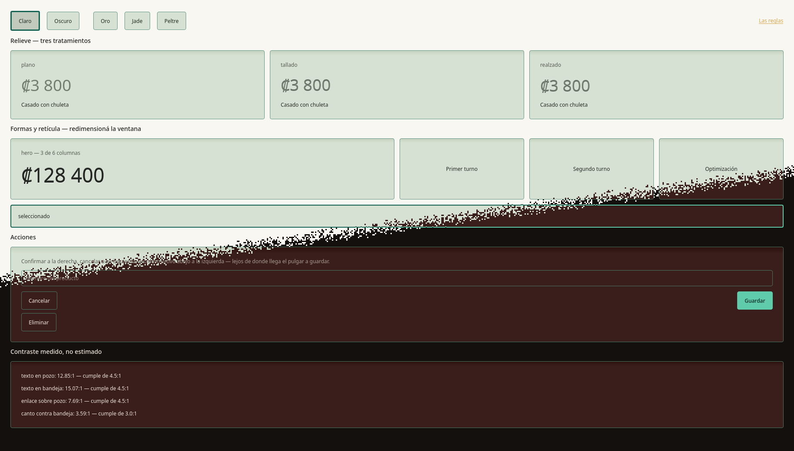
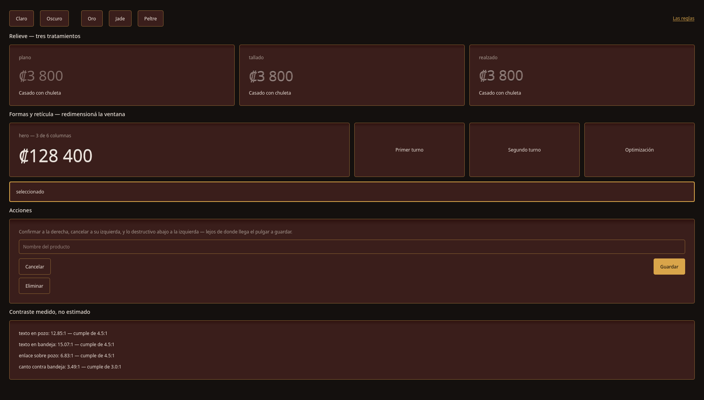
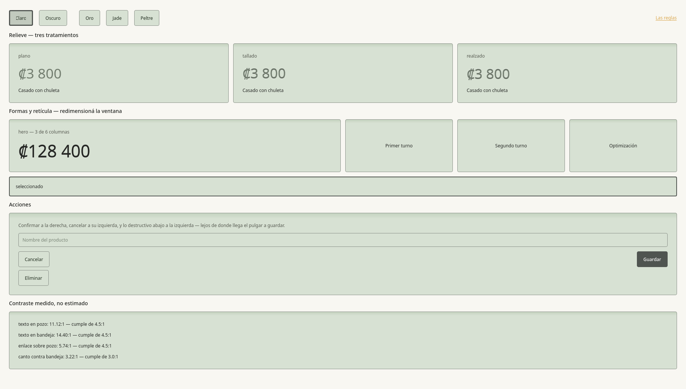

<div align="center">

# Wulfenite UI

**Un sistema de diseño, tres librerías gemelas: Flutter, Qt para Python y Jetpack Compose.**


</div>

---

## Qué es

Wulfenite UI es el sistema de diseño de las aplicaciones de NoctiVulp: **superficies lacadas con
canto metálico**, una retícula de seis columnas y componentes que llevan sus reglas dentro. El
nombre viene del mineral, de placas finas con brillo ámbar: una bandeja continua con pozos
hundidos, separados por un canto de un píxel que carga toda la profundidad.

El mismo sistema existe en tres librerías que comparten **los valores exactos**: los mismos
colores, el mismo espaciado, los mismos radios. Unas pruebas de paridad comparan cada port con
la versión de Dart, incluidos los colores derivados, y fallan si alguno se separa.

<p align="center">
  
</p>
<p align="center">
  
  
</p>

<p align="center"><sub>El banco de estilo del port de Qt (<code>PyQT/ejemplo/banco.py</code>). Las capturas se regeneran con <code>tools/capturas/capturas.py</code>.</sub></p>

## Paquetes

| | Flutter | Qt (Python) | Kotlin |
|---|---|---|---|
| Paquete | `wulf_flutter` | `wulf_qt` | `wulf-core` + `wulf-compose` |
| Cómo se aplica | `buildWulfTheme(WulfAcento.oro)` | `aplicar(app, Acento.ORO, Modo.OSCURO)` | `WulfTheme(WulfAcento.ORO) { }` |
| Ejemplo | `flutter/example/` | `PyQT/ejemplo/banco.py` | `Kotlin/ejemplo/` |

```
wulfenite_ui/
├── doc/reglas.md   las reglas que definen el sistema
├── flutter/        paquete Dart · wulf_flutter
├── PyQT/           paquete Python · wulf_qt
└── Kotlin/
    ├── wulf-core/      Kotlin puro: los valores, sin Android
    └── wulf-compose/   la capa de Android sobre ese núcleo
```

## Tecnologías

Flutter y Dart · PySide6 (Qt 6) · Kotlin, Jetpack Compose y Material 3 · íconos SVG propios,
generados por código.

## Documentación

- [`doc/reglas.md`](doc/reglas.md): las reglas del sistema.
- [`doc/guia.md`](doc/guia.md): guía completa de las tres librerías.

## Licencia

Código bajo **LGPL-3.0-or-later** ([`COPYING.LESSER`](COPYING.LESSER), que amplía la GPL-3.0 de
[`COPYING`](COPYING)). Se puede usar desde aplicaciones con cualquier licencia; las mejoras a la
propia librería se comparten en las mismas condiciones. Los componentes de terceros están en
[`NOTICE`](NOTICE). El nombre y la identidad visual no forman parte de la licencia: ver
[`TRADEMARKS.md`](TRADEMARKS.md). Para aportar, [`CONTRIBUTING.md`](CONTRIBUTING.md).

## Apoyo

Este proyecto forma parte del trabajo de **NoctiVulp**: herramientas para Linux y Android,
publicadas como software libre. Las compilaciones oficiales y las novedades salen en Patreon.

<p align="center">
  <a href="https://www.patreon.com/cw/NoctiVulp"></a>
</p>

---

<p align="center"><sub>© 2026 NoctiVulp · <b>Powered by AI</b> — desarrollado con la asistencia de Claude, de Anthropic.</sub></p>
